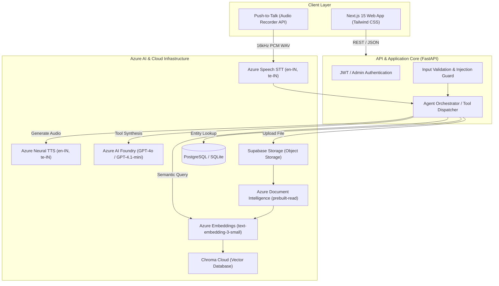

# CampusVoice

[](https://www.python.org/)
[](https://nextjs.org/)
[](https://fastapi.tiangolo.com/)
[](https://www.trychroma.com/)
[](https://azure.microsoft.com/)
[](LICENSE)

An enterprise-ready, multilingual (**English** & **Telugu**) conversational AI helpdesk designed for higher education institutions. **CampusVoice** delivers voice- and text-driven query resolution grounded **exclusively** in verified institutional artifacts (circulars, syllabi, scanned exam timetables) and relational campus records (schedules, faculty directory, academic calendars).

Built with zero-hallucination policy compliance: if an official source does not support an answer, the platform automatically routes the student inquiry into a tracked, department-specific support ticket.

---

## Key Capabilities

- **Zero-Hallucination Grounding**: Answers are derived strictly from retrieved official documents or live structured database queries. Never relies on parametric LLM memory for factual campus details.
- **Multilingual Voice & Text (EN / TE)**: Real-time bilingual query interaction with dual speech-to-text (`Azure AI Speech`, `en-IN` & `te-IN`), neural speech synthesis, and cross-lingual semantic matching.
- **OCR Ingestion Pipeline**: Ingests pure digital PDFs, scanned documents, and mobile snapshots (JPG/PNG). Features automatic pre-flight image optimization and rasterization using `Azure AI Document Intelligence`.
- **Dynamic Revision Lifecycle**: Circular revisions replace legacy policies (`supersedes_id`), ensuring outdated notices never pollute search indices.
- **Automated Helpdesk Escalation**: Inquiries outside institutional documentation or lacking threshold similarity are converted into department tickets with unique reference IDs.
- **Deterministic Prompt Injection & Scope Defense**: Layered regex and semantic guards reject malicious system overrides, prompt leaks, and personal data scraping prior to LLM execution.

---

## Architecture Overview



---

## Technology Stack

| Domain | Technology / Service | Description |
| :--- | :--- | :--- |
| **Frontend** | [Next.js 15](https://nextjs.org/) + [React 19](https://react.dev/) + [Tailwind CSS](https://tailwindcss.com/) | Responsive interface with audio recorder and admin control panel |
| **Backend** | [FastAPI](https://fastapi.tiangolo.com/) + [Python 3.12](https://www.python.org/) | Async REST API, Pydantic settings, rate limiting, and session control |
| **LLM & Agent** | [Azure AI Foundry](https://ai.azure.com/) (`GPT-4o` / `GPT-4.1-mini`) | Tool-calling agent with strict grounding and deterministic safety guards |
| **Embeddings** | [Azure OpenAI](https://learn.microsoft.com/en-us/azure/ai-services/openai/) (`text-embedding-3-small`) | 1536-dimensional multilingual embeddings |
| **Vector DB** | [ChromaDB Cloud](https://cloud.trychroma.com/) / Local Client | Cosine similarity vector store for indexed document chunks |
| **Speech (STT / TTS)** | [Azure AI Speech](https://azure.microsoft.com/en-us/products/ai-services/speech-services) | Real-time dual-language STT and neural TTS (`NeerjaNeural`, `ShrutiNeural`) |
| **Document OCR** | [Azure AI Document Intelligence](https://azure.microsoft.com/en-us/products/ai-services/ai-document-intelligence) | Prebuilt-read layout model with automatic client-side compression |
| **Storage & DB** | [Supabase](https://supabase.com/) & [SQLAlchemy](https://www.sqlalchemy.org/) + [Alembic](https://alembic.sqlalchemy.org/) | S3-compatible object storage and PostgreSQL/SQLite relational schema |

---

## Project Structure

```text
ascend_week1/
├── backend/
│   ├── alembic/                # Database migrations
│   ├── app/
│   │   ├── db/                 # Models, connection sessions, seed scripts
│   │   ├── routers/            # API Endpoints (chat, voice, admin, docs, health)
│   │   ├── schemas/            # Pydantic validation schemas
│   │   ├── scripts/            # CLI utilities (hashing, threshold tuning, seeds)
│   │   ├── services/           # Core logic (audio, embeddings, LLM agent, OCR, storage)
│   │   ├── tools/              # Agent tools (exams, timetable, events, faculty)
│   │   ├── config.py           # Typed environment settings
│   │   └── main.py             # FastAPI entrypoint and lifespan hooks
│   ├── Dockerfile              # Production Dockerfile with ffmpeg
│   ├── render.yaml             # Render deployment configuration
│   └── requirements.txt        # Backend dependencies
├── frontend/
│   ├── src/                    # Next.js App Router (pages, audio recorder, UI components)
│   ├── vercel.json             # Vercel deployment spec and security headers
│   └── package.json            # Frontend scripts and dependencies
├── data/                       # Sample institutional records and circulars
└── docs/                       # Architecture, test scenarios, and security reports
```

---

## Getting Started

### Prerequisites

- **Python**: 3.12+
- **Node.js**: 20+ with npm
- **FFmpeg**: Required on the backend host for raw audio processing

---

### 1. Backend Setup

```powershell
# Navigate to backend directory
cd backend

# Create and activate virtual environment
py -3.12 -m venv .venv
.\.venv\Scripts\Activate.ps1

# Install dependencies
pip install -r requirements.txt

# Configure environment variables
Copy-Item .env.example .env
# Edit .env with your Azure, Chroma Cloud, and Supabase credentials

# Execute database migrations
alembic upgrade head

# Seed institutional records (faculty, timetable, events, exams)
python -m app.db.seed

# Start the development server
uvicorn app.main:app --reload --port 8000
```

The backend API documentation will be accessible at:
- **Swagger UI**: `http://localhost:8000/docs`
- **Health Check**: `http://localhost:8000/health`

---

### 2. Frontend Setup

```powershell
# In a new terminal, navigate to the frontend directory
cd frontend

# Install package dependencies
npm install

# Configure environment variables
Copy-Item .env.example .env.local

# Launch the Next.js development server
npm run dev
```

Open `http://localhost:3000` in your browser. The administrative dashboard is available at `http://localhost:3000/admin`.

---

## Environment Configuration

Both backend and frontend contain dedicated `.env.example` templates.

### Backend (`backend/.env`)

```env
# Core
APP_ENV=development
COLLEGE_NAME="Geethanjali College of Engineering and Technology"
FRONTEND_ORIGIN=http://localhost:3000
DATABASE_URL=sqlite:///./campusvoice.db
LOG_LEVEL=DEBUG

# Chroma Cloud
CHROMA_API_KEY=ck-your-api-key
CHROMA_TENANT=your-tenant-uuid
CHROMA_DATABASE=campusvoice
CHROMA_COLLECTION_NAME=campusvoice_chunks
SIMILARITY_THRESHOLD=0.30

# Azure AI Foundry (LLM & Embeddings)
AZURE_AI_FOUNDRY_ENDPOINT=https://<your-resource>.openai.azure.com/
AZURE_AI_FOUNDRY_API_KEY=your-azure-key
AZURE_AI_FOUNDRY_DEPLOYMENT=gpt-4.1-mini
AZURE_AI_FOUNDRY_API_VERSION=2024-10-21
EMBEDDING_PROVIDER=azure
AZURE_EMBEDDING_DEPLOYMENT=text-embedding-3-small
AZURE_EMBEDDING_DIMENSION=1536

# Azure Speech (STT & TTS)
AZURE_SPEECH_KEY=your-speech-key
AZURE_SPEECH_REGION=southeastasia
AZURE_SPEECH_STT_LANGUAGES=en-IN,te-IN
AZURE_SPEECH_TTS_VOICE_EN=en-IN-NeerjaNeural
AZURE_SPEECH_TTS_VOICE_TE=te-IN-ShrutiNeural

# Azure Document Intelligence (OCR)
OCR_PROVIDER=azure
AZURE_DOCUMENT_INTELLIGENCE_ENDPOINT=https://<your-ocr-resource>.cognitiveservices.azure.com/
AZURE_DOCUMENT_INTELLIGENCE_KEY=your-ocr-key

# Storage (Supabase)
SUPABASE_URL=https://<your-project>.supabase.co
SUPABASE_SERVICE_ROLE_KEY=your-supabase-service-key
SUPABASE_STORAGE_BUCKET=campusvoice-documents

# Admin Authentication (JWT)
JWT_SECRET=your-32-character-random-secret
ADMIN_PASSWORD_HASH='$2b$12$...'  # python -m app.scripts.hash_password
```

### Frontend (`frontend/.env.local`)

```env
NEXT_PUBLIC_API_URL=http://localhost:8000
```

---

## Production Deployment

### Backend on Render

The repository includes a ready-to-use [`render.yaml`](file:///c:/Users/viven/Desktop/ascend_week1/backend/render.yaml):

1. Link your GitHub repository in the **Render Dashboard**.
2. Select **New Blueprint Instance** and target `backend/render.yaml`.
3. Provide the non-synced credentials in the Render Environment Variables tab (Azure keys, Supabase credentials, Chroma Cloud tokens, and JWT secrets).
4. Update `FRONTEND_ORIGIN` with your live frontend domain.

### Frontend on Vercel

Configured via [`frontend/vercel.json`](file:///c:/Users/viven/Desktop/ascend_week1/frontend/vercel.json):

1. Import the repository in **Vercel**.
2. Set the **Root Directory** to `frontend`.
3. Add the environment variable:
   - `NEXT_PUBLIC_API_URL`: Your deployed Render backend URL (e.g., `https://campusvoice-backend.onrender.com`).
4. Deploy.

---

## Security & Verification Standards

- **Hardened Ingestion**: Files undergo triple-check validation (extension, MIME type header, and binary magic-byte inspection).
- **Injection & PII Protection**: Deterministic pre-flight regex guards neutralize prompt injections, system prompt leak attempts, and student personal record requests (marks/grades/phone numbers).
- **Sanitized Logging**: All application logging preserves privacy—no student questions, raw audio payloads, or credential secrets are printed.
- **Strict Role-Based Access**: Administrative routes (`/api/admin/*`) require cryptographically verified bcrypt-hashed JWT tokens with explicit expiration.

---

## Testing & Quality Assurance

```powershell
# Run backend test suite (unit, integration & mocked Azure calls)
cd backend
python -m pytest -q

# Run frontend type-checking and production build verification
cd ../frontend
npm run typecheck
npm run build
```

---

## License

Distributed under the MIT License. See `LICENSE` for more information.
